<h1 align="center">Hi 👋 I'm Ahmed Hassan</h1>

Computer Science Student | Frontend | Problem Solver

---

## 👨‍💻 About Me

I'm a Computer Science student at **Capital University – Faculty of Computers Science and AI** (Since September 2024).

I began my programming journey in Secondary 3 with Python, and since then I've been building a strong foundation in software engineering, problem solving, Frontend, Backend, and system-level thinking.

I’m passionate about understanding how things work under the hood — from programming languages and runtime systems to performance optimization and Software architecture.

---

## 🛠 Tech Stack

### 💻 Programming Languages

  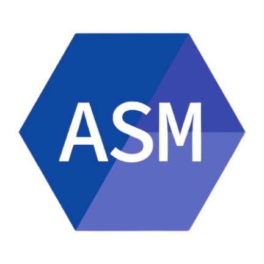
  
  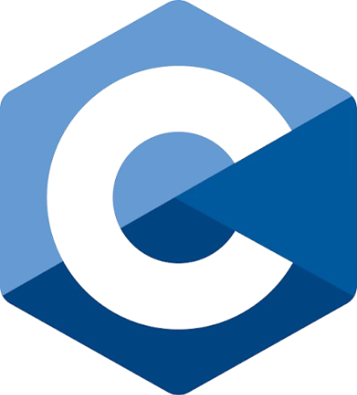
  
  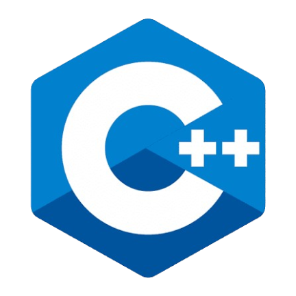
  
  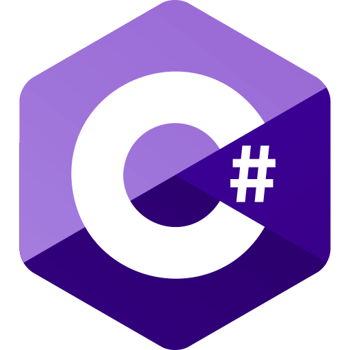
  
  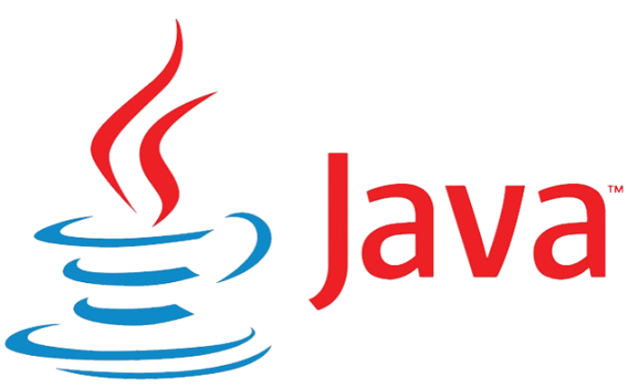
  
  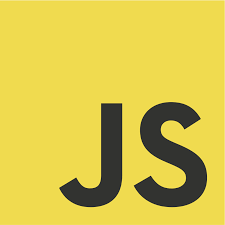
  
  
  
  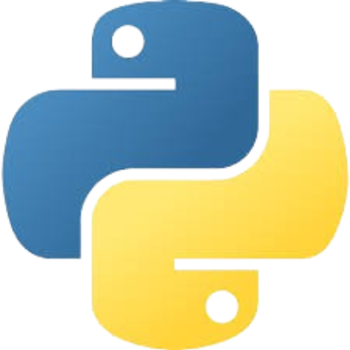
  
  
  
  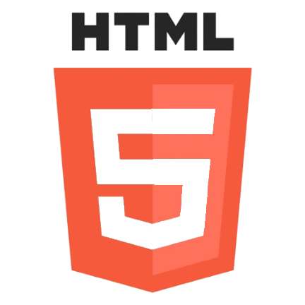
  
  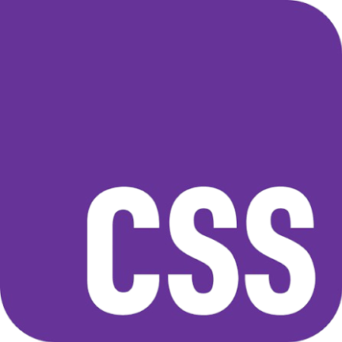
  
  
  
  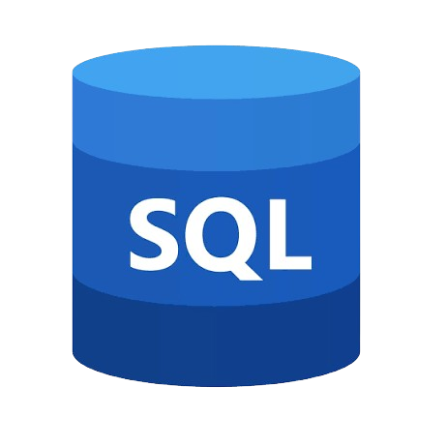

---

### 🚀 Frameworks & Tools

  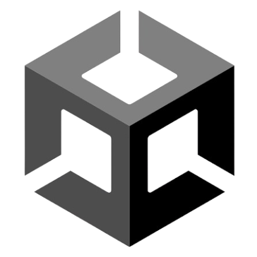
  
  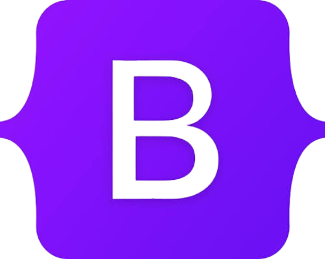
  
  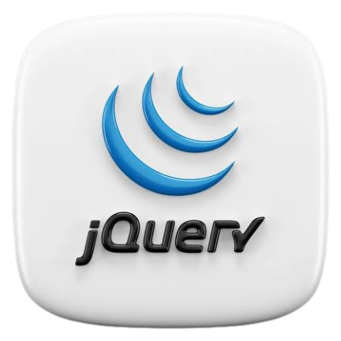
  
  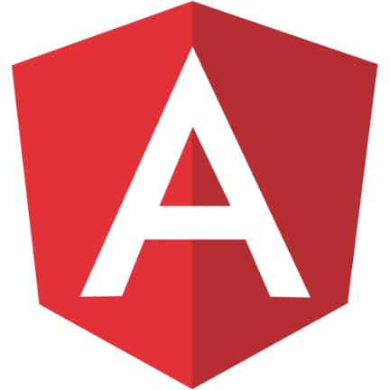
  
  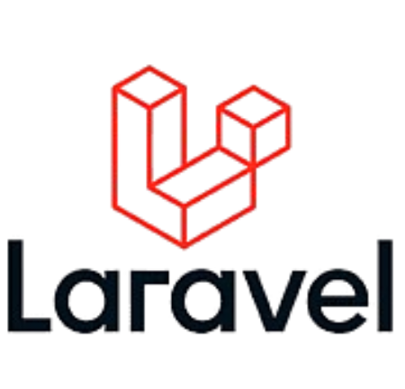

---

### 🗄 Databases

  
  
  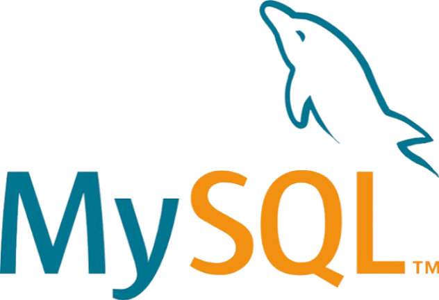
  
  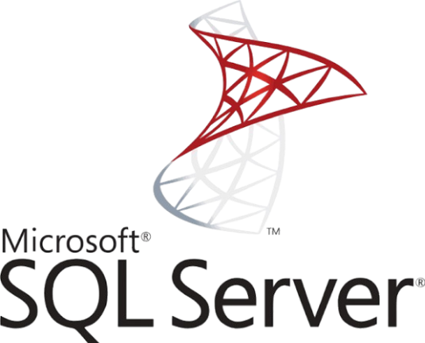
  
  

---

## 📚 Academic & Self-Learning Journey

- 🐍 Started with Python
- 🔵 C fundamentals & structured programming
- 🌐 HTML, CSS, JavaScript
- 🎮 C# & Unity Game Engine
- ☕ OOP With Java, SQL & Data Structures & Algorithms
- ⚡ Competitive Programming with C++ (Codeforces)
- 🔄 Currently exploring: Assembly, AI, Multithread Programming, Angular, Laravel

---

## 🎯 Interests

- Programming language design & internals
- Data structures & Algorithms  
- Performance optimization  
- Backend development  

---

## 💡 Fun Fact

> I don’t just like writing code — I like understanding how things work internally.

---

Always learning. Always building. 🚀

